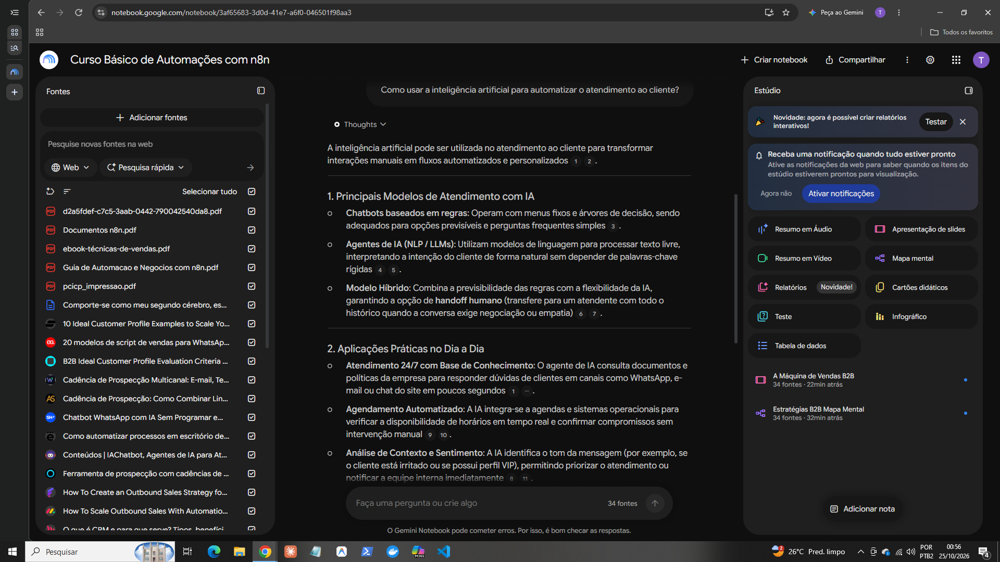

# Segundo cérebro: automação e organização de dados para pequenos negócios

Projeto do desafio da DIO "segundo cérebro com IA", feito no Gemini Notebook (antigo NotebookLM).

## Tema e objetivo

> Quero um especialista que me ajude a prospectar, diagnosticar, propor e negociar serviços de automação com n8n e organização de dados para pequenos negócios, como clínicas e estúdios no Brasil, para que eu consiga fechar meus primeiros clientes pagantes.

## Fontes que entraram e por que confio nelas

Critérios que usei para aceitar uma fonte:

1. Serve ao objetivo: ajuda em pelo menos uma etapa (prospectar, diagnosticar, propor ou negociar) ou na parte técnica (n8n e dados).
2. Tem autor ou instituição identificável.
3. Está atualizada, principalmente as de n8n, que muda rápido.
4. É prática: mostra como fazer.
5. Posso compartilhar: não tem dado pessoal nem material que eu não possa tornar público.

### Parte técnica: n8n e automação

| Fonte | Tipo | Por que confio |
|---|---|---|
| Documentos n8n: "Crie seu primeiro fluxo de trabalho" (impressão da documentação oficial, 24/10/2026) | PDF | Documentação oficial da própria ferramenta e recente. Ensina gatilho, requisição HTTP, expressões e tabela de dados, passo a passo. |
| Playlist de n8n da Hashtag Treinamentos: PREENCHER_LINK | Vídeo | Empresa que conheço, com didática clara e aulas práticas. |
| Vídeo sobre benefícios das automações: PREENCHER_TITULO_CANAL_E_LINK | Vídeo | PREENCHER_MOTIVO |

### Prospecção, diagnóstico e negociação

| Fonte | Tipo | Por que confio |
|---|---|---|
| *Prospecção de clientes: identifique seus clientes potenciais* (Senac/SC, 2020, 60 páginas) | PDF | Instituição de ensino profissional. Cobre persona, mapa de empatia, necessidades x desejos e processo de decisão de compra. Limite: é de 2020 e voltado ao comércio. |
| *Prospectando clientes: como aumentar a sua carteira* (e-book Estácio, 24 páginas) | PDF | Material de universidade que cita autores de administração de vendas (Castro, Neves e Cônsoli, 2018; Chiavenato, 2014; Futrell, 2014). Cobre prospecção, qualificação, abordagem e pós-venda. |
| *Técnicas de vendas: estratégias para conquistar, manter e encantar o cliente* (Sebrae/SC, 14 páginas) | PDF | O Sebrae é referência em pequenos negócios, que é o meu público. É a principal fonte de negociação: tipos de objeção (rejeição, adiamento e investigação), perguntas de venda e formas de fechamento. |
| *Como Vender Qualquer Coisa para Qualquer Um*: PREENCHER_AUTOR | Audiobook | Livro de técnicas de abordagem e fechamento de vendas. |

### Síntese própria

| Fonte | Tipo | Observação |
|---|---|---|
| *Guia de Automação e Negócios com n8n* | PDF | eu, a partir de pesquisas. Reúne ideias de automação por nicho (clínicas, estúdios e contabilidade), pacotes de serviço e scripts de abordagem. Os valores em R$ e percentuais, como "até 80% menos faltas", são hipóteses de trabalho, não dados verificados. Vou validá-los com clientes reais. |

### Artigos e páginas da web

Entraram pela pesquisa do próprio Gemini Notebook. Mantive as que tratam de perfil de cliente ideal, cadência de prospecção, scripts de venda, CRM e atendimento com IA, que são os temas do meu objetivo.

- 10 Ideal Customer Profile Examples to Scale Yo... 
- B2B Ideal Customer Profile Evaluation Criteria... 
- 20 modelos de script de vendas para WhatsAp...
- Cadência de Prospecção Multicanal: E-mail, Te... 
- Cadência de Prospecção: Como Combinar Lin.
- Chatbot WhatsApp com IA Sem Programar e... 
- Como automatizar processos em escritório de... 
- Conteúdos | IAChatbot, Agentes de IA para At... 
- Ferramenta de prospecção com cadências de... 
- How To Create an Outbound Sales Strategy fo... 
- How To Scale Outbound Sales With Automatio...
- O que é CRM e para que serve? Tipos, benefíci...


## Diretriz de comportamento dada ao notebook

```text
Comporte-se como meu segundo cérebro, especializado em automação com n8n e organização de dados para pequenos negócios, como clínicas e estúdios. Atue como uma consultora experiente que me orienta a como prospectar, diagnosticar, propor e negociar até fechar meus primeiros clientes pagantes.

Responda apenas com base nas fontes do notebook e indique de qual fonte vem cada ponto. Se as fontes não cobrirem a pergunta, diga isso claramente em vez de inventar.

Use linguagem simples, como se eu fosse uma iniciante em vendas e em tecnologia. Sempre que possível, dê exemplos práticos para clínicas e estúdios e termine com o próximo passo que posso tomar.

Não peça nem use dados pessoais de pacientes ou clientes. Quando o assunto envolver dados de saúde ou LGPD, avise-me para ter cuidado e procurar orientação profissional.
```

## Perguntas, respostas e fontes

### Pergunta 1: como usar IA no atendimento ao cliente

**"Como usar a inteligência artificial para automatizar o atendimento ao cliente?"**

Resumo da resposta do notebook:

- **Três modelos de atendimento:** chatbots baseados em regras (menus fixos, bons para perguntas simples), agentes de IA com modelos de linguagem (entendem texto livre) e modelo híbrido, com transferência para um atendente humano quando a conversa pede negociação ou empatia.
- **Aplicações práticas:** atendimento 24 horas consultando uma base de conhecimento, agendamento automatizado, análise de contexto e sentimento para priorizar atendimentos, e execução de ações por ferramentas (consultar estoque, registrar em planilhas, atualizar CRM).
- **Estrutura de implementação:** um gatilho (por exemplo, nova mensagem no WhatsApp), instruções e memória para a IA lembrar da conversa, e uma infraestrutura conectada por API oficial (como a WhatsApp Cloud API) a uma plataforma de automação visual, como o n8n.

**Fontes citadas pelo notebook:

Prints: Prints: 
[](2026-10-25.png) 
[.png)](2026-10-25\ \(1\).png)

## Materiais gerados no Estúdio

- Apresentação de slides "A Máquina de Vendas B2B": https://notebook.google.com/notebook/3af65683-3d0d-41e7-a6f0-046501f98aa3/artifact/d19c0f84-9e27-4c52-b835-fba4fa6cfc54?utm_source=nlm_web_share&utm_medium=google_oo&utm_campaign=art_share_1&utm_content=&utm_smc=nlm_web_share_google_oo_art_share_1_
  
- Mapa mental "Estratégias B2B": [[materiais/estrategias-b2b-mapa-mental.png](materiais/estrategias-b2b-mapa-mental.png)
](https://notebook.google.com/notebook/3af65683-3d0d-41e7-a6f0-046501f98aa3/artifact/2ec29184-ee20-45ce-b4bd-121426c2c15d?utm_source=nlm_web_share&utm_medium=google_oo&utm_campaign=art_share_1&utm_content=&utm_smc=nlm_web_share_google_oo_art_share_1_)

## Link do notebook compartilhado
https://notebook.google.com/notebook/3af65683-3d0d-41e7-a6f0-046501f98aa3

## Limites e cuidados

- O Gemini Notebook pode cometer erros, então conferi as respostas nas citações.
- Os valores e percentuais do guia de síntese própria são hipóteses a validar.
- As fontes de terceiros não estão neste repositório. Os links levam às versões originais.
- Nenhuma fonte contém dados pessoais de clientes ou pacientes.
